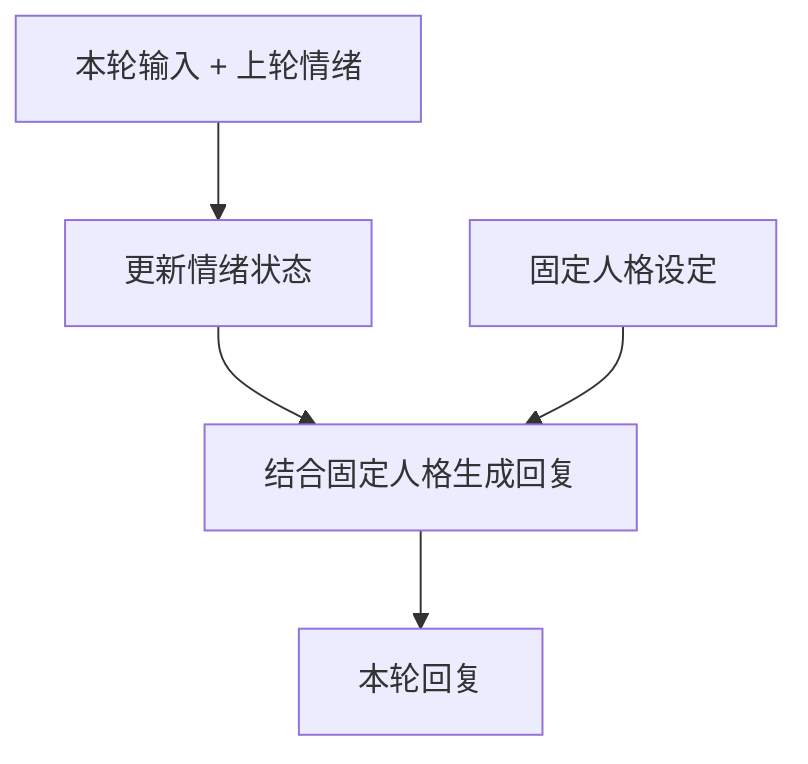

# English Paper Reading Skill

用中文精读英文 AI、机器学习和 NLP 论文的 Codex skill。适合想在一遍阅读中理顺**研究问题、方法流程、关键公式和实验逻辑**的读者。

## 安装与使用

```bash
mkdir -p ~/.agents/skills
git clone https://github.com/hallielu113-arch/english-paper-reading-skill.git ~/.agents/skills/english-paper-reading
```

在 Codex 输入框选择 `$english-paper-reading`，附上论文 PDF 或链接。例如：

> 用 $english-paper-reading 精读这篇论文。请重点讲清状态更新公式，以及消融实验如何验证这个模块。我的课题是多轮角色模拟中的人格稳定性。

## 输出包含什么

- **开篇**：英文模型或方法名、3–5 个关键词、论文要解决的问题。
- **方法**：先画 Mermaid 流程图，再按原文章节讲解模块，用独立公式块展示关键公式，并用一条样本走完流程。
- **实验**：按作者想验证的主张用 ①、②、③ 编排，给出关键对照表、原文出处和证据边界。
- **注释与启发**：有需要时解释心理学概念或实验范式；全文末尾结合读者课题提出一个可执行的小实验。

## 效果展示

以下为**虚构示例和演示数值**，用于展示版式，不代表任何论文的实测结果。

**方法名**：Context-State Update（CSU）

**关键词**：角色模拟 · 情境变化 · 状态更新

**解决的问题**：对话情境变了，角色的情绪应随之变化，但稳定的人格偏好不应被每一轮输入覆盖。

### 模型方法总览



### 理论设计：新情境如何改变状态？

情绪更新在上一轮状态与本轮情境信号之间取加权平均。

$$
s_t = (1-\alpha)s_{t-1} + \alpha c_t
$$

例如，上轮情绪状态为 0.2，本轮情境信号为 0.8，若权重为 0.5，则更新后的状态为 0.5。生成回复时使用新状态，人格设定保持不变。

### ① 状态更新有助于匹配情境吗？

同样的底座和人格设定下，对比冻结情绪状态与逐轮更新。百分比是演示值。

| 设置 | 情绪匹配率 ↑ | 人格一致性 ↑ |
| --- | ---: | ---: |
| 冻结情绪状态 | 62% | 81% |
| 逐轮更新 | 76% | 82% |

> **读表提示**：情绪匹配率相差 14 个百分点；人格一致性只相差 1 个百分点。没有重复试验和误差范围时，后者不足以判断人格一致性有所改善。

---

### 对我的课题带来的思考

可以给同一角色设计两组多轮对话：一组中途改变情境，一组保持情境不变。分别测量情绪是否作出恰当反应、角色的选择偏好是否跨轮稳定。

## 文件

- [SKILL.md](SKILL.md)：完整中文阅读规则。
- [agents/openai.yaml](agents/openai.yaml)：Codex 中的英文显示名称。
